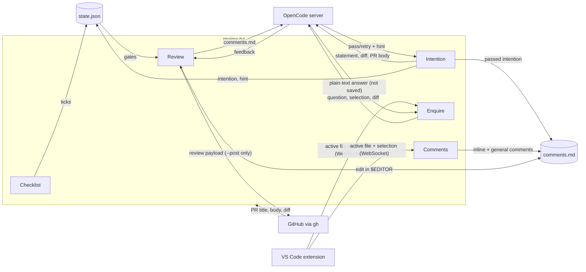

# Review TUI wireframe

What is on screen in review-tui, page by page, which keys do what, and where data goes. The wireframes are drawn from `src/tui.ts` and `src/start.ts`; the text is illustrative, the layout is real. For installing and running, see the [README](../README.md); for where the code lives, see [`repo-layout.md`](repo-layout.md).

## Layout shared by every page

After the start page, every page has the same six rows, top to bottom:

```
┌──────────────────────────────────────────────────────────────────────────┐
│                                                         ✻ In The Loop  ① │
│ ◀ [ Checklist ]  Intention  Enquire  Comments  Review ▶  (1/5)  PR #7: … ②│
│                                                                          │
│  Page body: differs per page (below)                                   ③ │
│                                                                          │
│ status line: messages, errors, "working…"                              ④ │
│ > input box (Intention, Enquire and Comments pages only)               ⑤ │
│ ←/→ pages · Ctrl+C quit · page-specific keys                           ⑥ │
└──────────────────────────────────────────────────────────────────────────┘
```

| #   | Row      | Contents                                                                         |
| --- | -------- | -------------------------------------------------------------------------------- |
| ①   | Corner   | Small "In The Loop" logo, right-aligned                                          |
| ②   | Tab bar  | The five pages with the current one in `[ ]`, the page number and the PR title   |
| ③   | Body     | The page itself                                                                  |
| ④   | Status   | Last message; errors in red, blockers in amber, "working…" while the LLM runs     |
| ⑤   | Input    | One-line text box, shown only where the page takes typed input                   |
| ⑥   | Key hint | Keys that work on this page right now                                            |

The outer box is only for the diagram. The real screen has no border.

## Start page

Shown on launch, and again on resume. A resumed review returns to its saved page after Enter.

```
┌──────────────────────────────────────────────────────────────────────────┐
│                                                                          │
│                      ▀█▀ █▄ █   ▀█▀ █ █ █▀▀                              │
│                       █  █ ▀█    █  █▀█ █▀▀     (logo, medium letters)   │
│                      ▄█▄ █  █    █  █ █ █▄▄                              │
│                                                                          │
│                      █       ███   ███  ████                             │
│                      █      █   █ █   █ █   █   (logo, large letters)    │
│                      █████  █   █ █   █ ████                             │
│                                                                          │
│                      R E V I E W  -  T U I                               │
│                                                                          │
│                      repo: owner/name                                    │
│                      branch: swe-21-review-tui-wireframe-doc             │
│                      model: anthropic/claude-sonnet-5-5                  │
│                                                                          │
│                      Press Enter to start                                │
│                      Press m to select model                             │
│                                                                          │
│ Enter start · m change model · Ctrl+C quit                               │
└──────────────────────────────────────────────────────────────────────────┘
```

Pressing `m` swaps the prompt for a model picker between the `model:` line and the prompt:

```
│                      model: anthropic/claude-sonnet-5-5                  │
│                      filter: son▏                                        │
│                      > anthropic/claude-sonnet-5-5  Sonnet 5.5           │
│                        openrouter/…/sonnet…         …                    │
│                      1/2                                                 │
│                      Enter select                                        │
```

| Key      | Action                                    |
| -------- | ----------------------------------------- |
| Enter    | Start the review (or, in the picker, select the highlighted model) |
| `m`      | Open the model picker                     |
| Type     | Filter models by provider, ID or name     |
| ↑/↓      | Move in the picker                        |
| Esc      | Close the picker without changing         |
| Ctrl+C   | Quit                                      |

## Checklist page

Eleven steps from Google's engineering-practices code review guide. No LLM. All must be ticked before the Review page unlocks.

```
┌──────────────────────────────────────────────────────────────────────────┐
│ ◀ [ Checklist ]  Intention  Enquire  Comments  Review ▶  (1/5)  PR #7    │
│                                                                          │
│ > [x] Design: is the overall design sound and does it belong here?       │
│   [ ] Functionality: does it do what the author intended, …?             │
│   [ ] Complexity: could it be simpler? Any over-engineering?             │
│   [ ] Tests: are there correct, useful tests?                            │
│   …                          (11 items in all)                           │
│   [ ] Good things: did I note what the author did well?                  │
│                                                                          │
│ ←/→ pages · Ctrl+C quit · ↑/↓ move · space tick                          │
└──────────────────────────────────────────────────────────────────────────┘
```

`>` marks the cursor. Ticked items turn grey. There is no input box.

## Intention page

The reviewer states, in their own words, what the PR changes and why. A judge model says `pass` or `retry` and, on retry, gives a hint. It never states the intention itself.

```
┌──────────────────────────────────────────────────────────────────────────┐
│ ◀ Checklist  [ Intention ]  Enquire  Comments  Review ▶  (2/5)  PR #7    │
│                                                                          │
│ In your own words: what does this PR change, and why?                    │
│ (The reviewer states it; the judge only says pass/retry.)                │
│                                                                          │
│ retry · Hint: Say what behaviour changes for users, not only the files.  │
│                                                                          │
│ Your last attempt: Adds a wireframe doc                                  │
│                                                                          │
│ working…                                                                 │
│ > your intention…                                                        │
│ ←/→ pages · Ctrl+C quit · type + Enter submit · Esc leave input          │
└──────────────────────────────────────────────────────────────────────────┘
```

After a `pass` the body is replaced by `🔒 Locked: intention accepted and saved to comments.md` followed by the reviewer's text, and the input box disappears.

| Key   | Action                         |
| ----- | ------------------------------ |
| Type  | Write the intention            |
| Enter | Submit to the judge            |
| Esc   | Leave the input so ←/→ work    |

## Enquire page

Select code in VS Code, ask a question, get a plain-text explanation. The model explains; it does not review. Answers are never saved. Never locked, not a gate. Design: [`design/enquire-page.md`](design/enquire-page.md).

```
┌──────────────────────────────────────────────────────────────────────────┐
│ ◀ Checklist  Intention  [ Enquire ]  Comments  Review ▶  (3/5)  PR #7    │
│                                                                          │
│ Ask about the code you selected. You judge; the model explains.          │
│ Subject: src/llm.ts:L42-48                                             ① │
│                                                                          │
│ ── src/llm.ts:L42-48                                                   ② │
│   const res = await client.session.prompt({                              │
│   … (3 more lines)                                                       │
│ Q: Why is a fresh session created per call?                            ③ │
│ A: Each call is independent, so no history leaks between …             ④ │
│                                                                          │
│ thinking…                                                              ⑤ │
│ > your question…                                                         │
│ ←/→ pages · Ctrl+C quit · type a question + Enter · /ide connect         │
└──────────────────────────────────────────────────────────────────────────┘
```

1. **Subject**: the current VS Code selection, or a hint to select code or run `/ide`.
2. **Excerpt**: the first four selected lines, frozen at the moment the question was sent.
3. **Question**: what the reviewer typed.
4. **Answer**: the model's reply, in the model colour. The last five exchanges are shown and are kept for this run only.
5. **Thinking**: a glowing status while the request is in flight.

| Input | Action                                         |
| ----- | ---------------------------------------------- |
| Type  | Write a question                               |
| Enter | Ask                                            |
| `/ide`, `/ide N`, `/ide off` | Scan for, pick or disconnect VS Code |
| Esc   | Leave the input                                |

## Comments page

Where most of the time is spent. Each comment is appended to `comments.md`.

```
┌──────────────────────────────────────────────────────────────────────────┐
│ ◀ Checklist  Intention  Enquire  [ Comments ]  Review ▶  (4/5)  PR #7    │
│                                                                          │
│ Add: comment on the selection   (or: general: text for the review body)  │
│ IDE: Visual Studio Code connected · src/llm.ts:L42-48                  ① │
│ Files in diff:                                                         ② │
│   src/llm.ts                                                             │
│   README.md                                                              │
│                                                                          │
│ Comments (2):                                                          ③ │
│   src/llm.ts:L42-48 — Why not reuse the session here?                   │
│   README.md:L3 — Typo: "teh".                                            │
│                                                                          │
│ Added on src/llm.ts:L42-48.                                              │
│ > path:line comment                                                      │
│ ←/→ pages · Ctrl+C quit · Enter add · Esc leave input                    │
└──────────────────────────────────────────────────────────────────────────┘
```

1. **IDE line**: the connection and what VS Code is showing. Without a selection it suggests `42 comment`.
2. **Files in diff**: only lines in the PR diff can be commented on.
3. **Comments**: what is in `comments.md` now, including edits made on the Review page.

| Input                  | Meaning                                         |
| ---------------------- | ----------------------------------------------- |
| `path:line comment`    | Comment on one line                             |
| `path:10-15 comment`   | Comment on a range                              |
| `general: text`        | Add to the review body                          |
| `42 comment`           | Line in the open VS Code file (no selection)    |
| `42-48 comment`        | Range in the open VS Code file (no selection)   |
| text only              | Comment on the VS Code selection                |
| `/ide`, `/ide N`, `/ide off` | Scan for, pick or disconnect VS Code      |

## Review page

Gated: `s` and `p` need a complete checklist, a passed intention and at least one comment.

```
┌──────────────────────────────────────────────────────────────────────────┐
│ ◀ Checklist  Intention  Enquire  Comments  [ Review ] ▶  (5/5)  PR #7    │
│                                                                          │
│ Gates: blocked: checklist incomplete, no comments yet                  ① │
│ Mode: dry run                                                          ② │
│                                                                          │
│ Feedback on your comments (LLM):                                       ③ │
│ …                                                                        │
│                                                                          │
│ Payload:                                                               ④ │
│ { "event": "COMMENT", "body": "[reviewer + model] …", … }                │
│                                                                          │
│ ←/→ pages · Ctrl+C quit · s start review · e edit comments.md · p dry-run│
└──────────────────────────────────────────────────────────────────────────┘
```

1. **Gates**: `all passed`, or what is missing.
2. **Mode**: `dry run` or red `POST (live)` with `--post`.
3. **Feedback**: one-shot LLM feedback on accuracy and fairness, after `s`.
4. **Payload**: the review that `p` built, also saved to `payload.json`.

| Key | Action                                                          |
| --- | --------------------------------------------------------------- |
| `s` | Ask the LLM for feedback on the comments                        |
| `e` | Edit `comments.md` in `$EDITOR` (the TUI pauses, then resumes)  |
| `p` | Build the payload; post it only with `--post`, else dry run     |

## Key bindings

| Key             | Where                          | Action                                      |
| --------------- | ------------------------------ | ------------------------------------------- |
| Ctrl+C          | Everywhere                     | Quit                                        |
| ←/→             | After start                    | Previous / next page (wraps). While typing, only when the input is empty |
| Esc             | Input pages                    | Leave the input so ←/→ always work          |
| Enter or `i`    | Input pages, input off         | Type again                                  |
| Enter           | Start page                     | Start; in the picker, select                |
| `m`             | Start page                     | Open model picker                           |
| ↑/↓, Space      | Checklist                      | Move, tick / untick                         |
| Enter           | Intention, Enquire, Comments   | Submit the input                            |
| `s`, `e`, `p`   | Review                         | Start review, edit comments, post / dry run |

## How data flows

Three things feed the review: what the reviewer types, what VS Code reports, and what the LLM says back. The reviewer is always the one who writes into `comments.md`.



In words, per pane:

- **Checklist** reads and writes only `state.json`.
- **Intention** sends the reviewer's statement, the PR description and the diff to the `review-judge` agent in OpenCode. Only a parsed `pass` or `retry` and a length-capped hint come back, and a hint that copies the PR description is replaced. On `pass`, the reviewer's own text goes into the Intention section of `comments.md`.
- **Enquire** sends the question, the current VS Code selection and the diff to the read-only `review-enquire` agent. The answer is shown and then dropped. It never reaches `comments.md`, the Review page or GitHub.
- **Comments** takes the file and lines from the typed text or from the VS Code selection, checks them against the diff, and appends to `comments.md`. No LLM.
- **Review** checks the gates from `state.json` and `comments.md`, sends `comments.md` to the judge for feedback on `s`, and on `p` prefixes every comment with `[$REVIEWER + $MODEL]`, writes `payload.json` and, with `--post`, posts one GitHub review.

### VS Code selection

The extension in `vscode-extension/` runs a local WebSocket server and publishes `active_file` and `selection` messages; review-tui only listens. Selections are mapped from workspace-relative to repo-relative paths. The Enquire page sends the selected text to the model; the Comments page uses only the path and line numbers. Protocol: [`ide-protocol.md`](ide-protocol.md).

### The LLM

All LLM calls go to a local OpenCode server (or `OPENCODE_URL`), each in a fresh session, using the model chosen on the start page (saved in `state.json`). The agents are read-only and live in `.opencode/agents/`: `review-judge.md` (Intention, Review feedback) and `review-enquire.md` (Enquire).
